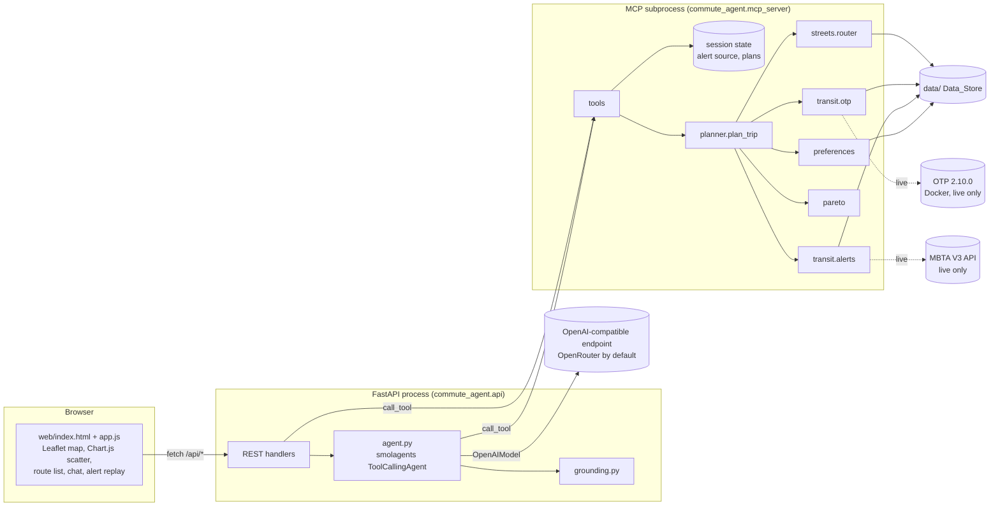

# Design Document

## Overview

This design turns a trip query inside Boston into a Pareto set of routes over four objectives, then lets an LLM agent explain the trade-offs. It is written for Claude Haiku 5.5 implementers working in parallel. Every shared type, path, function signature, file format, and tool schema is fixed here. An implementer who needs a contract that this document does not define stops and asks the coordinator instead of inventing one.

The design follows four rules.

- **Types first.** `commute_agent/models.py` and `commute_agent/paths.py` land before any feature code. Every workstream builds and tests against them and against shared fixtures.
- **One owner per file.** The file ownership table assigns each file to one workstream. Nobody edits a file they do not own.
- **Validate at boundaries only.** Ingest, config load, HTTP handlers, and MCP tools validate input. Internal functions trust typed arguments.
- **Pure core, thin shell.** Pareto logic, risk math, alert matching, preference fitting, and number grounding are pure functions with no I/O.

Facts checked while writing this design, on 2026-10-24:

- OpenTripPlanner 2.10.0 is the latest release (2026-09-09). The GTFS GraphQL endpoint is `/otp/gtfs/v1`. `planConnection` is the supported query, and `PlanModesInput.transitOnly` exists. `Leg.intermediateStops` is deprecated in favor of `stopCalls` but still present in 2.10.0. `Stop.parentStation` exists. `Trip.directionId` is a `String`.
- smolagents is at 1.26.0. Its `MCPClient` depends on `mcpadapt` 0.1.20, which imports `streamablehttp_client`. MCP SDK 2.x renamed that function, so smolagents fails to import with `mcp==2.3.0`. A prototype on 2026-10-24 worked with `mcp==1.30.0`. The server class there is `FastMCP` from `mcp.server.fastmcp`, and `mcp.run()` defaults to stdio.
- With `MCPClient(params, structured_output=True)`, each tool is a callable that returns the tool's structured dict. A raising tool returns the string `Error executing tool <name>: <message>` instead of raising. A Pydantic field marked `Field(exclude=True)` breaks output validation, so hidden fields must be emptied, not excluded.
- `ToolCallingAgent(tools, model, instructions=..., max_steps=...)` takes extra system instructions. `agent.run(task, reset=False)` continues a conversation. `agent.memory.steps` holds `ActionStep` objects with `tool_calls` (name, arguments, id) and `observations`.
- `OpenAIModel(model_id=..., api_base=..., api_key=...)` (alias `OpenAIServerModel`) reaches any OpenAI-compatible endpoint, including OpenRouter at `https://openrouter.ai/api/v1` and Ollama at `http://localhost:11434/v1`. It needs the `smolagents[openai]` extra.
- LiteLLM was dropped on 2026-10-24. `litellm==1.106.3` imports `CacheableResult` from `mcp.types` on its completion path, which `mcp==1.30.0` lacks, so every agent step failed. A bare `litellm.completion` call did not reproduce it; the import happens through the agent's tool-calling path.
- OpenRouter lists `deepseek/deepseek-v4.1-flash-1017` with tool calling, a 1,048,576-token context, and $0.15 / $0.60 per million input and output tokens (checked 2026-10-24).
- OSMnx is at 2.1.1. Routing lives in `ox.routing.shortest_path`, snapping in `ox.distance.nearest_edges`, speeds in `ox.routing.add_edge_speeds` and `ox.routing.add_edge_travel_times`.
- MBTA V3 alerts carry `effect` (for example `NOTICE`, `SUSPENSION`), integer `severity`, `active_period` with nullable `end`, and `informed_entity` items with `route`, `stop`, `route_type`, `direction_id`, `activities`. Entities list both child stop ids (`70105`) and parent station ids (`place-brntn`).
- Boston Vision Zero has 44,986 rows (2015-01-01 to 2026-09-01). `mode_type` is `mv`, `ped`, or `bike`. Cambridge police crashes have 17,230 rows (2015 to 2026-09-30). `may_involve_cyclist` and `may_involve_pedestrian` are `"1"` or empty, and `location` is an object with `latitude` and `longitude` strings.
- Boston Numina has nine zone CSVs (zones 51600, 51671, 52110, 52112 to 52117) with `zone_id, metric, objClass, result, time` and no coordinates. That is why the user supplies `data/raw/numina_zones.csv`.
- Somerville counts are one-hour screen-line counts on weekday mornings (start 07:15 to 07:45) and evenings (start 16:45 to 17:15), with `mode` of `Bike` or `Ped`. Cambridge citywide counts use 15-minute bins from 07:30 to 09:15 (AM) and 16:30 to 18:45 (PM).
- The Bluebikes November 2024 zip holds `202411-bluebikes-tripdata.csv` and a `__MACOSX` entry that must be skipped. It has 397,406 rows, 516 start stations, 63,085 station pairs, and 634 rows without an end station.
- The MassGIS rapid transit layer returns point geometry when queried with `returnGeometry=true&outSR=4326`.
- The MBTA GTFS zip is 22 MB. The Geofabrik Massachusetts PBF is 311 MB. The BBBike Boston extract URL returns 404.

## Architecture



Plans and choices live in the MCP subprocess. The REST handlers call MCP tools for planning, alerts, and choices. The agent calls the same tools. A `query_id` that the map shows is therefore the same `query_id` the agent can compare and record. The API process holds conversations and one alert source per browser session, keyed by the `X-Session-Id` header, and passes that source to `plan_trip` and `get_active_alerts` on every call.

### Request flow for one plan

1. `planner.plan_trip` checks both points against the Boston boundary.
2. `streets.router.street_routes` returns walk, bike, bluebikes, and drive candidates.
3. `transit.otp.fetch_itineraries` returns a raw OTP response from cache (offline) or OTP (live). `transit.otp.transit_routes` converts it to candidates and scores each walk leg for crash risk. A second request, `fetch_itineraries(..., access="bike")`, asks for bike-access itineraries (`PLAN_QUERY_BIKE`, `BICYCLE` for access, egress and transfer). Its cache key carries `;access=bike`, so walk-access keys are unchanged. `transit_routes` scores its bike legs with `score_bike_coords` on the bike graph and labels them "Bike" in the route summary, e.g. "Bike, then Red Line". Offline, a missing bike entry omits these routes without an omit reason.
4. `transit.alerts.apply_disruptions` sets disruption risk on transit legs from the active alert source.
5. `pareto.pareto_front` filters. `pareto.assign_labels` labels. `pareto.tradeoff` compares each member with the fastest.
6. `preferences.order_routes` orders members by the current weights.
7. The MCP server stores the `PlanResult` under its `query_id` and returns it.

### Offline and live

| Concern | Offline (default) | Live (`--live`) |
|---|---|---|
| Transit | `data/cache/otp/<key>.json` | POST to `http://localhost:8080/otp/gtfs/v1`, then write the cache |
| Alerts `live` source | Disabled | GET `https://api-v3.mbta.com/alerts?filter[route_type]=0,1,3` |
| Alerts `MBTA live` source | Selectable; same GET, cached 60 s; a failed fetch gives no alerts and a note (`PlanResult.alert_note`) | Same as offline |
| Map basemap | `data/processed/basemap.geojson` | OSM tiles plus the same basemap |
| LLM provider | Used, unless the model is local (for example Ollama) | Used |

## Workstreams and file ownership

WS0 runs alone first. After WS0 merges, WS1 through WS10 run in parallel against fixtures. Real data flows in during milestone M2.

| WS | Name | Owns |
|---|---|---|
| WS0 | Scaffold and contracts | `pyproject.toml`, `uv.lock`, `.python-version`, `.gitignore`, `commute_agent/__init__.py`, `commute_agent/models.py`, `commute_agent/paths.py`, `commute_agent/routes.py`, `tests/conftest.py`, `tests/fixtures/**`, `tests/test_routes.py` |
| WS1 | Ingest and emission factors | `commute_agent/ingest/**`, `commute_agent/emissions.py`, `commute_agent/check_offline.py`, `data/showcase_trips.yaml`, `data/emission_factors.example.yaml`, `tests/test_ingest_*.py`, `tests/test_emissions.py`, `tests/test_check_offline.py` |
| WS2 | Street graphs, exposure, crash risk | `commute_agent/streets/build.py`, `commute_agent/streets/risk.py`, `commute_agent/streets/exposure.py`, `tests/test_risk.py`, `tests/test_exposure.py` |
| WS3 | Street routing | `commute_agent/streets/router.py`, `commute_agent/streets/__init__.py`, `tests/test_router.py` |
| WS4 | Transit and disruptions | `commute_agent/transit/**`, `docker/otp/**`, `data/alert_snapshots/**`, `tests/test_otp.py`, `tests/test_alerts.py` |
| WS5 | Pareto and planner | `commute_agent/pareto.py`, `commute_agent/planner.py`, `tests/test_pareto.py`, `tests/test_planner.py` |
| WS6 | Preferences | `commute_agent/preferences.py`, `tests/test_preferences.py` |
| WS7 | MCP server, agent, grounding | `commute_agent/mcp_server.py`, `commute_agent/gazetteer.py`, `commute_agent/agent.py`, `commute_agent/grounding.py`, `tests/test_mcp_server.py`, `tests/test_gazetteer.py`, `tests/test_agent.py`, `tests/test_grounding.py` |
| WS8 | API server | `commute_agent/api.py`, `tests/test_api.py` |
| WS9 | Web UI | `web/**`, `webapp/**` |
| WS10 | Eval and docs | `eval/**`, `README.md` |

## Data Store layout

```
data/
  emission_factors.yaml          user-supplied, committed
  emission_factors.example.yaml  WS1, committed, all values null
  showcase_trips.yaml            WS1, committed
  alert_snapshots/*.json         WS4, committed
  raw/                           gitignored; starter zips and downloads
    numina_zones.csv             user-supplied
  processed/                     gitignored
    boston_boundary.geojson
    crash_coverage.geojson       Boston union Cambridge
    crashes.parquet
    counts.parquet
    bluebikes_trips.parquet
    bluebikes_stations.parquet
    rapid_transit_stations.parquet
    walk.graphml  bike.graphml  drive.graphml
    exposure_calibration.json
    risk_meta.json
    basemap.geojson
    *.meta.json                  sidecar per processed file
  otp/                           gitignored; OTP graph inputs and graph.obj
  cache/otp/*.json               gitignored; raw OTP responses
  preferences.db                 gitignored
```

`.gitignore` adds `data/raw/`, `data/processed/`, `data/otp/`, `data/cache/`, and `data/preferences.db`. The eval results files are committed.

## Data Models

WS0 owns `commute_agent/models.py`.

WS0 writes this file exactly. Changes after M0 go through the coordinator.

```python
from datetime import datetime
from typing import Literal

from pydantic import BaseModel

RouteKind = Literal["walk", "bike", "bluebikes", "drive", "transit"]
LegMode = Literal[
    "walk", "bike", "bluebikes", "drive",
    "subway", "light_rail", "bus", "commuter_rail", "ferry",
]
ACTIVE_LEG_MODES: frozenset[LegMode] = frozenset({"walk", "bike", "bluebikes"})
Objective = Literal["time_min", "co2_g", "crash_risk", "disruption_risk"]
OBJECTIVES: tuple[Objective, ...] = ("time_min", "co2_g", "crash_risk", "disruption_risk")
RiskBasis = Literal["bluebikes_proxy", "ped_counter", "road_class_prior", "outside_crash_coverage"]
UNKNOWN_EXPOSURE_BASES: frozenset[RiskBasis] = frozenset({"road_class_prior", "outside_crash_coverage"})
Label = Literal["fastest", "lowest_co2", "lowest_crash_risk", "least_disrupted"]
RunMode = Literal["offline", "live"]
Weekday = Literal["monday", "tuesday", "wednesday", "thursday", "friday", "saturday", "sunday"]


class Point(BaseModel):
    lat: float
    lon: float


class Objectives(BaseModel):
    time_min: float
    co2_g: float
    crash_risk: float
    disruption_risk: float


class TransitRef(BaseModel):
    route_id: str        # MBTA id with feed prefix removed, e.g. "Red", "Green-E", "SL1"
    route_name: str      # shortName or longName from OTP
    route_type: int      # GTFS route_type
    direction_id: int
    stop_ids: list[str]  # board, intermediate, alight stops plus their parent stations, deduplicated


class Leg(BaseModel):
    mode: LegMode
    coords: list[tuple[float, float]] = []  # (lon, lat), WGS84; emptied in agent-facing results
    distance_m: float
    duration_min: float
    co2_g: float
    crash_risk: float = 0.0
    risk_basis_m: dict[RiskBasis, float] = {}
    transit: TransitRef | None = None
    alert_ids: list[str] = []
    disruption_risk: float = 0.0


class RouteOption(BaseModel):
    id: str              # f"{kind}-{n}", unique within one PlanResult
    kind: RouteKind
    summary: str         # "Red Line from Fields Corner", "Bike, safer variant 2"
    legs: list[Leg]
    objectives: Objectives
    sources: dict[Objective, str]
    labels: list[Label] = []
    alert_ids: list[str] = []
    unknown_exposure_share: float = 0.0


class AlertEntity(BaseModel):
    route: str | None = None
    stop: str | None = None
    route_type: int | None = None
    direction_id: int | None = None


class ActivePeriod(BaseModel):
    start: datetime
    end: datetime | None = None


class Alert(BaseModel):
    id: str
    header: str
    effect: str
    severity: int
    active_periods: list[ActivePeriod]
    entities: list[AlertEntity]


class AlertSnapshot(BaseModel):
    label: str
    recorded_at: datetime
    synthetic: bool
    alerts: list[Alert]


class AlertRef(BaseModel):
    id: str
    header: str
    effect: str
    score: float | None  # None when the effect is not in EFFECT_SCORES


class Tradeoff(BaseModel):
    route_id: str
    reference_id: str
    delta: Objectives                    # route minus reference
    pct: dict[Objective, float | None]   # 100 * delta / reference, None when reference is 0
    alerts_avoided: list[AlertRef]       # affect the reference, not the route


class PreferenceWeights(BaseModel):
    weights: dict[Objective, float]
    n_choices: int
    insufficient_data: bool


class ChoiceEvent(BaseModel):
    query_id: str
    chosen_at: datetime
    chosen: Objectives
    rejected: list[Objectives]


class FilteredRoute(BaseModel):          # pareto.filtered_out: why a candidate left the set
    route: RouteOption
    reason: Literal["dominated", "near_duplicate"]
    by_route_id: str                     # a dominating route, a frontier one when possible
    by_summary: str
    by_objectives: Objectives

class PlanResult(BaseModel):
    query_id: str
    origin: Point
    destination: Point
    depart_at: datetime
    run_mode: RunMode
    alert_source: str
    routes: list[RouteOption]            # Pareto set, ordered by preference
    tradeoffs_vs_fastest: list[Tradeoff]
    omitted: dict[RouteKind, str]        # kind -> reason
    candidate_count: int
    unscored_alerts: list[AlertRef]
    preference: PreferenceWeights
    notes: list[str]                     # fixed caveats, e.g. "Drive time is free-flow and ignores traffic."
    filtered: list[FilteredRoute] = []   # candidates outside the Pareto set, for the UI only


class AlertsView(BaseModel):
    source: str
    synthetic: bool
    alert_clock: datetime | None
    alerts: list[AlertRef]


class AlertSources(BaseModel):
    sources: list[str]
    active: str
    live_enabled: bool


class EmissionFactor(BaseModel):
    value: float
    unit: Literal["g_per_passenger_km", "g_per_passenger_mile"]
    source: str


class ShowcaseTrip(BaseModel):
    name: str
    origin_name: str
    destination_name: str
    origin: Point
    destination: Point
    weekday: Weekday
    depart_local: str  # "HH:MM", America/New_York
    description: str


class ShowcaseTrips(BaseModel):
    trips: list[ShowcaseTrip]


class Place(BaseModel):
    name: str
    point: Point
    source: Literal["mbta_station", "bluebikes_station", "showcase", "coordinates"]


class GeocodeResult(BaseModel):
    status: Literal["ok", "ambiguous", "not_found"]
    candidates: list[Place]


class ToolCall(BaseModel):
    name: str
    input: dict
    output: dict | str
    is_error: bool


class AgentReply(BaseModel):
    conversation_id: str
    text: str
    tool_calls: list[ToolCall]
    unsupported_numbers: list[str]
```

## Components and Interfaces

### WS0. Paths (`commute_agent/paths.py`)

```python
from pathlib import Path

ROOT = Path(__file__).resolve().parent.parent
DATA = ROOT / "data"
RAW = DATA / "raw"
PROCESSED = DATA / "processed"
OTP_DIR = DATA / "otp"
OTP_CACHE = DATA / "cache" / "otp"
ALERT_SNAPSHOTS = DATA / "alert_snapshots"
EMISSION_FACTORS = DATA / "emission_factors.yaml"
SHOWCASE_TRIPS = DATA / "showcase_trips.yaml"
PREFERENCES_DB = DATA / "preferences.db"
NUMINA_ZONES = RAW / "numina_zones.csv"
WEB = ROOT / "web"
EVAL = ROOT / "eval"
```

Tests point code at fixtures by passing paths as arguments. Functions that read the Data_Store take a `Path` parameter whose default is the constant above.

### WS0. Route assembly (`commute_agent/routes.py`)

WS3 and WS4 both build `RouteOption` values from legs. One function owns the arithmetic.

```python
def assemble_route(route_id: str, kind: RouteKind, summary: str, legs: list[Leg],
                   time_source: str, co2_source: str, crash_source: str) -> RouteOption:
    """Sum time, CO2, and crash risk over legs. Take the max leg disruption risk.
    Union leg alert ids in leg order. Compute unknown_exposure_share as the
    UNKNOWN_EXPOSURE_BASES metres over all risk_basis_m metres (0.0 when there are none).
    sources["disruption_risk"] is DISRUPTION_SOURCE."""

def with_disruption(route: RouteOption, legs: list[Leg]) -> RouteOption:
    """Return a copy with new legs, recomputed disruption_risk and alert_ids. Other objectives unchanged."""

DISRUPTION_SOURCE = "MBTA alerts scored by the prototype's effect table (heuristic index, 0 to 1)"
```

### WS1. Raw data (`scripts/fetch/`, already curated)

Downloads are done. Four stdlib scripts in `scripts/fetch/` fetched every raw file into `data/raw/<group>/` and wrote one `MANIFEST.json` per group with source URL, retrieval time, SHA-256, bytes, true CSV record count, and license. Rerunning a script skips files already present and rewrites its manifest. Ingest reads only these files, with one exception. The `graphs` step downloads from Overpass once, because OSMnx's walk, bike, and drive filters exist only as Overpass queries.

| Group | File under `data/raw/` | Records | License |
|---|---|---|---|
| crashes | `crashes/boston_vision_zero.csv` | 44,986 | ODC PDDL |
| crashes | `crashes/cambridge_police_crashes.csv` | 17,230 | ODC PDDL |
| counts | `counts/cambridge_citywide_bike_counts.csv` | 238,799 | ODC PDDL |
| counts | `counts/somerville_bike_ped_counts.csv` | 2,532 | ODC ODbL |
| counts | `counts/numina/zone_<id>.csv` (9 files) and `counts/numina/docs/*.pdf` (5) | 24,965 or 35,400 each | ODC PDDL |
| counts | `counts/numina/numina_zones.candidate.csv` | 9 | from the Numina PDFs |
| transit | `transit/MBTA_GTFS.zip` (Fall 2026, valid 2026-10-14 to 2026-12-12) | | MBTA developer license |
| transit | `transit/mbta_routes.json` | 8 | MBTA developer license |
| transit | `transit/mbta_alerts_<UTC>.json` | 61 | MBTA developer license |
| transit | `transit/massgis_rapid_transit_stations.json` (with WGS84 points) | 170 | MassGIS |
| transit | `transit/202411-bluebikes-tripdata.zip` | 397,406 | Bluebikes data license |
| geo | `geo/boston_boundary.geojson` (land only, 125.1 km², 34 polygons) | 1 | ODC PDDL |
| geo | `geo/cambridge_boundary.geojson` | 1 | Cambridge GIS |
| geo | `geo/massachusetts-latest.osm.pbf` (Geofabrik, 2026-10-23) | | ODbL 1.0 |
| geo | `geo/boston.osm.pbf`, clipped to `-71.22,42.20,-70.89,42.42` | | ODbL 1.0 |

`numina_zones.candidate.csv` maps the 9 zones to their 3 sensor sites (Jackson Square 42.322802,-71.100588; 50 Northern Ave 42.353630,-71.046128; Tremont and Boylston 42.352371,-71.064498), quoting the project overview PDF page 2. The zones are sub-areas of one camera each, so every zone carries its site's point. The user confirms it by copying it to `data/raw/numina_zones.csv`, which `paths.NUMINA_ZONES` names.

### WS1. Ingest (`commute_agent/ingest/`)

Entry point `uv run python -m commute_agent.ingest <dataset>`. `__main__.py` maps names to functions. Each function takes `raw_dir: Path = RAW, out_dir: Path = PROCESSED` and returns the written path. Each writes a sidecar with `write_meta(path, source_manifest_entry, row_count, notes)` from `ingest/meta.py`, copying source URL and license from the raw `MANIFEST.json` entry.

Column checks use one helper, `require_columns(df, dataset, expected: set[str])`, which raises `SchemaMismatch` naming missing columns. `__main__` catches `SchemaMismatch`, prints it, and exits 2. Each function writes to `<path>.tmp` and renames, so a failed run leaves the old file.

| Dataset name | Module | Reads | Output and columns |
|---|---|---|---|
| `boundary` | `geo.py` | `geo/boston_boundary.geojson`, `geo/cambridge_boundary.geojson` | `boston_boundary.geojson` (dissolved), `crash_coverage.geojson` (Boston union Cambridge) |
| `graphs` | `geo.py` | `ox.graph_from_polygon(boston_buffered_2km, network_type=...)` for `walk`, `bike`, `drive`, with `ox.settings.use_cache = True` and `ox.settings.cache_folder = "data/raw/geo/overpass_cache"` | `walk.graphml`, `bike.graphml`, `drive.graphml` |
| `basemap` | `geo.py` | drive graph edges with highway in primary, secondary, tertiary, trunk | `basemap.geojson`, LineStrings simplified to 5 m |
| `crashes` | `crashes.py` | both crash CSVs | `crashes.parquet`: `source_dataset`, `occurred_at` (UTC), `mode` (`bike` or `ped`), `lat`, `lon` |
| `counts` | `counts.py` | counts CSVs, Numina zone CSVs, `numina_zones.csv` | `counts.parquet`: `source`, `location_id`, `lat`, `lon`, `mode` (`bike` or `ped`), `peak_hour_volume`, `n_sessions` |
| `bluebikes` | `bluebikes.py` | zip member `202411-bluebikes-tripdata.csv` only | `bluebikes_trips.parquet`: `start_station_id`, `end_station_id`, `trips`. `bluebikes_stations.parquet`: `station_id`, `name`, `lat`, `lon` (median of trip coordinates) |
| `stations` | `mbta.py` | `transit/massgis_rapid_transit_stations.json` | `rapid_transit_stations.parquet`: `name`, `line`, `lat`, `lon` |
| `otp-inputs` | `mbta.py` | `transit/MBTA_GTFS.zip`, `geo/boston.osm.pbf` | copies to `data/otp/mbta-gtfs.zip` and `data/otp/boston.osm.pbf` |
| `all` | `__main__.py` | runs the above in table order | |

The Overpass cache under `data/raw/geo/overpass_cache` makes a rerun of `graphs` work offline.

Column names below are exactly as they appear in the curated CSVs.

Crash rules in `crashes.py`:

- Vision Zero columns are `dispatch_ts, mode_type, location_type, street, xstreet1, xstreet2, x_cord, y_cord, lat, long`. `dispatch_ts` looks like `2015-12-23 02:25:08+00` (UTC). Rows with `mode_type` `bike` or `ped` become one row each. `mv` rows are dropped. One bike row lies east of the old clip box in the harbor and is kept.
- The Cambridge CSV has 159 columns. Use `Date Time` (`MM/DD/YYYY hh:mm:ss AM`, local time without zone, localize to America/New_York), `May involve cyclist`, `May Involve Pedestrian` (`1` or empty), and `Location`. `Location` is a multiline string `<address>\nCambridge, MA\n(<lat>, <lon>)`. Parse lat and lon from the trailing parentheses with `\((-?\d+\.\d+), (-?\d+\.\d+)\)$`.
- Only 8,878 of 17,230 Cambridge rows have coordinates. 1,815 have an empty `Location` and 6,537 have an address only. Drop rows without coordinates and record both counts in the sidecar notes. The README states that Cambridge crash coverage is about half the records.
- A Cambridge row flagged cyclist produces a `bike` row. A row flagged pedestrian produces a `ped` row. A row with both produces both. Flag counts are cyclist only 1,633, pedestrian only 863, both 306, before the coordinate filter.
- The sidecar `notes` field says: "Boston Vision Zero and Cambridge police records use different crash definitions. Neither is the MassDOT state crash file."

Peak-hour conversion rules in `counts.py`:

- Cambridge citywide. Keep `Year >= 2018`, which leaves 22 count locations. Group by `Count Location` and `Date`. Sum `Count`. Divide by hours counted, which is the number of distinct `Time` values times 0.25 (bins run 07:00 to 09:15 and 16:00 to 18:45). Average across dates per location. Mode `bike`. Coordinates are `Latitude` and `Longitude`.
- Somerville. Columns are `Year, Location #, Location Name, Latitude, Longitude, AM/PM, Mode, Count`. Keep `Year >= 2018`. Group by `Location Name`, `Year`, `Mode`. Sum the AM and PM counts and divide by 2 (one hour each, per the dataset description). Average across years. Map `Bike` to `bike` and `Ped` to `ped`.
- Numina. Zone ids are 51600, 51671, 52110, 52112, 52113, 52114, 52115, 52116, 52117 (there is no 52111). Every file is hourly with `metric == "count"` only. Keep weekdays and local hours 7, 8, 16, 17, 18. Mean `result` per zone and `objClass`. Map `bicycle` to `bike` and `pedestrian` to `ped`. Zones at one site watch overlapping areas of one camera, so per site and mode, `peak_hour_volume` is the maximum zone mean, not the sum. Join site coordinates from `numina_zones.csv` on `zone_id`. A zone missing from that file is a `SchemaMismatch`.

Bluebikes notes. The CSV columns are `ride_id, rideable_type, started_at, ended_at, start_station_name, start_station_id, end_station_name, end_station_id, start_lat, start_lng, end_lat, end_lng, member_casual`. There are 515 named start stations with a clean id-to-name mapping. Drop the 112 rows with a blank start station and the 541 rows with a blank end station. Drop stations outside the 2 km-buffered Boston boundary after computing medians, which removes the Salem and Hingham clusters.

`record-alert-snapshot <label>` lives in `transit/alerts.py` (WS4), not here.

### WS1. Emission factors (`commute_agent/emissions.py`)

```python
REQUIRED_MODES: tuple[LegMode, ...] = get_args(LegMode)

class EmissionFactorsError(Exception): ...

def load_emission_factors(path: Path = EMISSION_FACTORS) -> dict[LegMode, EmissionFactor]:
    """Raise EmissionFactorsError naming the path and required fields when the file is missing,
    and naming every offending mode and field when entries are missing or invalid."""

def leg_co2_g(factors: dict[LegMode, EmissionFactor], mode: LegMode, distance_m: float) -> float:
    """distance_m / 1000 * value for g_per_passenger_km; distance_m / 1609.344 * value for g_per_passenger_mile."""

def co2_source(factors: dict[LegMode, EmissionFactor], modes: Iterable[LegMode]) -> str:
    """'; '.join(f"emission_factors.yaml: {m} ({factors[m].source})") for each distinct mode in first-seen order."""
```

Every entry point (`api`, `mcp_server`, `eval.run`, `transit.cache_trips`) calls `load_emission_factors()` first and exits 2 with the error text on `EmissionFactorsError`.

`data/emission_factors.example.yaml`:

```yaml
# Copy to emission_factors.yaml and fill every value with a sourced factor.
walk:          {value: null, unit: g_per_passenger_km, source: ""}
bike:          {value: null, unit: g_per_passenger_km, source: ""}
bluebikes:     {value: null, unit: g_per_passenger_km, source: ""}
drive:         {value: null, unit: g_per_passenger_km, source: ""}
subway:        {value: null, unit: g_per_passenger_km, source: ""}
light_rail:    {value: null, unit: g_per_passenger_km, source: ""}
bus:           {value: null, unit: g_per_passenger_km, source: ""}
commuter_rail: {value: null, unit: g_per_passenger_km, source: ""}
ferry:         {value: null, unit: g_per_passenger_km, source: ""}
```

### WS6. Traffic factors (`commute_agent/traffic.py`)

`data/traffic_factors.yaml` multiplies free-flow drive time by a factor per day type and hour bucket (America/New_York local time). Buckets per day type: `0-6`, `6-7`, `7-9`, `9-15`, `15-16`, `16-19`, `19-24`. Each bucket has a `value` (a number at least 1.0) and a `source`. A bucket with `source: "needs a source"` must have `value: 1.0`, so no unsourced number is ever applied.

```python
class TrafficFactorsError(Exception): ...

@dataclass(frozen=True)
class TrafficFactors:
    buckets: tuple[TrafficBucket, ...]
    note: str | None = None
    def factor_for(self, depart_at: datetime) -> TrafficBucket: ...  # weekend = Sat/Sun

def load_traffic_factors(path: Path = TRAFFIC_FACTORS) -> TrafficFactors: ...  # missing file: 1.0 everywhere with a note
def free_flow_factors(note: str | None = None) -> TrafficFactors: ...
```

`load_traffic_factors` raises `TrafficFactorsError` naming the path and each bad day type, bucket and field, including gaps or overlaps in the 0-24 coverage. `street_routes` takes `depart_at` and `traffic` and applies the factor to drive time only. Its time source names the day type, bucket, factor and source. The planner's drive note changes to "Drive time uses a time-of-day traffic factor (...)" only when the departure's factor is not 1.0. `data/traffic_factors.example.yaml` gives the shape with null values.

### WS1. Showcase trips (`data/showcase_trips.yaml`)

Coordinates are starting values. The WS1 test asserts each point is inside `boston_boundary.geojson` once that file exists (skipped on fixtures only).

```yaml
- name: fields-corner-to-downtown
  origin_name: Fields Corner, Dorchester
  destination_name: Downtown Crossing
  origin: {lat: 42.3003, lon: -71.0614}
  destination: {lat: 42.3555, lon: -71.0603}
  weekday: tuesday
  depart_local: "08:15"
  description: Red Line commute that the synthetic JFK/UMass to Park Street suspension disrupts.
- name: hyde-square-to-longwood
  origin_name: Hyde Square, Jamaica Plain
  destination_name: Longwood Medical Area
  origin: {lat: 42.3220, lon: -71.1106}
  destination: {lat: 42.3376, lon: -71.1046}
  weekday: tuesday
  depart_local: "08:15"
  description: Short trip where bike and walk compete with bus and the Green Line E branch.
- name: charlestown-to-copley
  origin_name: Monument Square, Charlestown
  destination_name: Copley Square
  origin: {lat: 42.3763, lon: -71.0607}
  destination: {lat: 42.3499, lon: -71.0770}
  weekday: tuesday
  depart_local: "08:15"
  description: Orange Line versus a bike route across the Charles River Dam.
- name: maverick-to-courthouse
  origin_name: Maverick Square, East Boston
  destination_name: Courthouse, Seaport
  origin: {lat: 42.3691, lon: -71.0396}
  destination: {lat: 42.3524, lon: -71.0465}
  weekday: tuesday
  depart_local: "08:15"
  description: Harbor crossing where driving uses a tunnel and transit uses the Blue Line and Silver Line.
- name: allston-to-boston-common
  origin_name: Harvard Ave and Brighton Ave, Allston
  destination_name: Park Street, Boston Common
  origin: {lat: 42.3530, lon: -71.1325}
  destination: {lat: 42.3564, lon: -71.0624}
  weekday: tuesday
  depart_local: "08:15"
  description: Green Line B branch versus Commonwealth Avenue bike lanes.
```

### WS1. Offline check (`commute_agent/check_offline.py`)

`required_offline_files(trips: list[ShowcaseTrip]) -> list[Path]` returns the emission factors file, the three GraphML files, both boundary files, `bluebikes_stations.parquet`, `rapid_transit_stations.parquet`, `basemap.geojson`, `risk_meta.json`, every committed snapshot, the vendored web files, and the OTP cache file for each Showcase_Trip. `main()` prints each missing path and exits 1 when any is missing. It prints `offline ready` and exits 0 otherwise.

### WS2. Street graph edge attributes

The raw GraphML from WS1 gets risk attributes in place. Walk and bike edges carry these attributes after `python -m commute_agent.streets.build`.

| Attribute | Type | Meaning |
|---|---|---|
| `length` | float | metres, from OSMnx |
| `highway` | str | OSM class; when OSMnx stores a list, the first element |
| `crashes` | int | snapped crash rows of the graph's mode (`bike` graph gets `bike`, `walk` graph gets `ped`) |
| `exposure` | float | Peak_Hour_Volume, always above 0 |
| `risk_basis` | str | one RiskBasis value |
| `risk` | float | `(crashes + SHRINKAGE_K * p * length / 1000) / exposure * RISK_SCALE` |

The drive graph carries `speed_kph` and `travel_time` from OSMnx and no risk attributes.

Load graphs with `ox.load_graphml(path, edge_dtypes={"crashes": int, "exposure": float, "risk": float})`.

`data/processed/risk_meta.json`:

```json
{
  "crash_window": {"boston_vision_zero": ["2015-01-01", "2026-09-01"], "cambridge_police": ["2015-01-01", "2026-09-30"]},
  "crashes_snapped": {"bike": 0, "ped": 0},
  "crashes_discarded_over_30m": {"bike": 0, "ped": 0},
  "mean_crashes_per_km": {"bike": 0.0, "ped": 0.0},
  "shrinkage_k": 1.0,
  "risk_scale": 1000.0,
  "crash_source_label": "Estimated crash risk index for walk and bike segments. Crashes from Boston Vision Zero (2015-01-01 to 2026-09-01) and Cambridge police (2015-01-01 to 2026-09-30) per estimated peak-hour volume. Drive and transit vehicle segments are not modeled."
}
```

Values shown are placeholders. The build writes real ones, and the router reads `crash_source_label` for every route's `sources["crash_risk"]`.

### WS2. Crash risk (`commute_agent/streets/risk.py`)

Pure functions over arrays. No file I/O.

```python
SNAP_MAX_M = 30.0
SHRINKAGE_K = 1.0
RISK_SCALE = 1000.0

def mean_crashes_per_km(crashes: np.ndarray, lengths_m: np.ndarray) -> float:
    """crashes.sum() / (lengths_m.sum() / 1000)."""

def edge_risk(crashes: np.ndarray, lengths_m: np.ndarray, exposure: np.ndarray,
              covered: np.ndarray, p: float) -> np.ndarray:
    """Vectorized risk. For edges where covered is False, the crash term is 0
    and only SHRINKAGE_K * p * length_km remains."""
```

`streets/build.py` owns I/O and orchestration.

```python
def snap_points(G_projected: nx.MultiDiGraph, xs: np.ndarray, ys: np.ndarray) -> tuple[list[tuple[int, int, int]], np.ndarray]:
    """ox.distance.nearest_edges(G_projected, xs, ys, return_dist=True)."""

def build_risk(mode: Literal["walk", "bike"], processed: Path = PROCESSED) -> dict:
    """Load <mode>.graphml, project to EPSG:26986, snap crashes and counters,
    compute exposure and risk, write attributes back onto the unprojected graph,
    save <mode>.graphml, and return the risk_meta fragment for this mode."""

def main() -> None:
    """build_risk("bike"), build_risk("walk"), then write risk_meta.json and exposure_calibration.json."""
```

Snapping projects the graph with `ox.projection.project_graph(G, to_crs="EPSG:26986")` and projects points with the same CRS through GeoPandas. Edge ids `(u, v, key)` are the same in both graphs, so attributes computed on the projected graph go back to the unprojected one by id. A crash whose snap distance exceeds `SNAP_MAX_M` is discarded and counted. An edge is covered when its midpoint lies inside `crash_coverage.geojson`.

OSMnx graphs hold both directions of a two-way street as separate edges. A crash snaps to one direction. `build_risk` adds the crash count to the reverse edge `(v, u, k')` with the same `osmid` when it exists, so both directions see the crash.

### WS2. Exposure (`commute_agent/streets/exposure.py`)

```python
PRIOR_MIN_EDGES = 20
MIN_MATCHED_COUNTERS = 10

def bluebikes_proxy(G_bike: nx.MultiDiGraph, trips: pd.DataFrame, stations: pd.DataFrame) -> dict[tuple[int, int, int], int]:
    """For each start station, run nx.single_source_dijkstra_path(G_bike, src_node, weight="length") once,
    then for each end station walk the path and add the trip count to each traversed edge,
    choosing the min-length key between consecutive nodes. Station nodes come from
    ox.distance.nearest_nodes on station coordinates. Skip trips whose end node is unreachable."""

def fit_calibration(proxy: np.ndarray, observed: np.ndarray) -> tuple[float, float]:
    """Least squares through the origin. Return (scale, r_squared).
    scale = sum(proxy * observed) / sum(proxy ** 2).
    r_squared = 1 - sum((observed - scale * proxy) ** 2) / sum((observed - observed.mean()) ** 2)."""

def road_class_prior(highway: pd.Series, exposure: pd.Series, measured: pd.Series) -> pd.Series:
    """For each edge, the median measured exposure of its highway class when that class has
    at least PRIOR_MIN_EDGES measured edges, else the median over all measured edges."""

class TooFewCounters(Exception): ...
```

Bike exposure. Edges with a non-zero proxy get `scale * proxy` and basis `bluebikes_proxy`. All other covered edges get `road_class_prior` with basis `road_class_prior`. Calibration uses only bike counters whose matched edge has a non-zero proxy. `build_risk` raises `TooFewCounters` when fewer than `MIN_MATCHED_COUNTERS` match.

Walk exposure. Edges matched to a `ped` counter get its `peak_hour_volume` (per-edge mean) and basis `ped_counter`. All others get the prior. The walk prior has few measured edges, so most walk edges fall back to the global median. The Unknown_Exposure_Share shows this to the user.

Walk station term (`commute_agent/streets/exposure.py`, feature 10). `station_entry_term` gives each edge midpoint the sum over MBTA stations within `STATION_CATCHMENT_M` (804.7 m, a half mile) of `entries_per_day * (1 - distance / STATION_CATCHMENT_M)`. Entries per day are 2025 gated entries from `commute_agent/ingest/ridership.py` (`station_entries.parquet`). `fit_linear(X, observed)` is least squares through the origin with one or more columns. `_walk_calibration` fits the matched ped counters twice: the leave-one-out road-class prior alone (`r_squared_before`), and the prior plus the station term (`r_squared_after`). The decision uses adjusted R² and requires both coefficients to be non-negative. `build_risk` uses the two-term fit for unmeasured walk edges only when `USE_STATION_ENTRIES` is True. It is False unless the decision adopts the term.

Edges outside the Crash_Coverage_Area get basis `outside_crash_coverage` regardless of exposure source.

`exposure_calibration.json` (bike keys at the top level, walk under `walk`):

```json
{"scale": 0.0, "r_squared": 0.0, "matched": {"cambridge_citywide": 0, "somerville": 0, "numina": 0}, "unmatched_over_30m": 0,
 "walk": {"matched_edges": 0, "station_catchment_m": 804.7, "station_entries_available": true, "r_squared_before": 0.0, "r_squared_after": 0.0, "adjusted_r_squared_before": 0.0, "adjusted_r_squared_after": 0.0, "coefficients": {"road_class_prior": 0.0, "station_entries_per_day": 0.0}, "adopted": false, "decision": "", "station_entries_used": false}}
```

Expected runtime of `bluebikes_proxy` is 516 single-source Dijkstra calls on the bike graph. Budget 30 minutes. If it runs longer, the owner reports the measured time to the coordinator before adding parallelism.

### WS3. Street router (`commute_agent/streets/router.py`)

```python
WALK_KPH = 4.8
BIKE_KPH = 15.0
BLUEBIKES_KPH = 13.0
RISK_MULTIPLIERS = (0.5, 2.0, 8.0)
SPEED_SOURCE = {
    "walk": "Assumed walking speed 4.8 km/h",
    "bike": "Assumed cycling speed 15 km/h",
    "bluebikes": "Assumed Bluebikes speed 13 km/h plus walking 4.8 km/h to and from stations",
    "drive": "OSMnx free-flow speeds from OSM maxspeed, imputed by road class",
}

@dataclass(frozen=True)
class StreetGraphs:
    walk: nx.MultiDiGraph
    bike: nx.MultiDiGraph
    drive: nx.MultiDiGraph
    stations: pd.DataFrame   # bluebikes_stations.parquet
    crash_source: str        # risk_meta.json crash_source_label

def load_street_graphs(processed: Path = PROCESSED) -> StreetGraphs: ...

def street_routes(graphs: StreetGraphs, factors: dict[LegMode, EmissionFactor],
                  origin: Point, destination: Point, depart_at: datetime | None = None,
                  traffic: TrafficFactors | None = None) -> tuple[list[RouteOption], dict[RouteKind, str]]:
    """Candidates for walk, bike, bluebikes, drive, and omitted kinds with reasons.
    Only drive uses depart_at: its free-flow time is multiplied by the traffic factor for that
    departure (see WS6). Without depart_at, drive time stays free-flow."""

def score_walk_coords(G_walk: nx.MultiDiGraph, coords: list[tuple[float, float]]) -> tuple[float, dict[RiskBasis, float]]:
    """Crash risk and metres per basis for an arbitrary walk polyline, used for OTP walk legs.
    For each consecutive coordinate pair, take the midpoint, find the nearest walk edge in one
    vectorized nearest_edges call, and add edge risk * min(1, segment_m / edge_length)."""
```

Search for walk, bike, and the bike part of bluebikes.

1. Snap origin and destination with `ox.distance.nearest_nodes`.
2. Fastest path with weight `length / speed_mps`. Record its time `T0` in seconds and risk `R0`.
3. For each `m` in `RISK_MULTIPLIERS`, when `R0 > 0`, set `lam = m * T0 / R0` and run `nx.shortest_path(G, s, t, weight=w)` with `w(u, v, edges) = min(e["length"] / speed_mps + lam * e["risk"] for e in edges.values())`. On a MultiDiGraph, NetworkX passes the dict of parallel edges keyed by edge key as the third argument.
4. Convert each node path to edges by picking, between each consecutive pair, the key that minimizes the same weight. Drop a path whose edge list equals an earlier one.
5. Build each leg with `coords` from edge `geometry` when present, else from node `x`, `y`.

Drive uses `ox.routing.shortest_path(G_drive, s, t, weight="travel_time")` and one route.

Bluebikes picks the station nearest the origin and the station nearest the destination by straight-line distance. When both are the same station, bluebikes is omitted with reason `same station at both ends`. Its walk legs use the fastest walk path. Its bike leg runs the same λ sweep on the bike graph with mode `bluebikes`. The summary names both stations.

Live availability (`commute_agent/bluebikes_live.py`) applies only when `COMMUTE_BLUEBIKES_LIVE=1`. `fetch_availability` discovers the GBFS `station_status` feed from `https://gbfs.bluebikes.com/gbfs/gbfs.json` (English feed list; the feed itself is served from `gbfs.lyft.com`), with a 5 s timeout per request and a 60 s module cache that also caches failures. It returns counts keyed by both the GBFS `station_id` and `legacy_id`, because the trip data keys stations by legacy id. When counts are known, the start station must have `num_bikes_available > 0` and `is_renting`, the end station must have `num_docks_available > 0` and `is_returning`, and a station missing from the feed is not used. Selection stays nearest-first among eligible stations, and the counts appear in the `time_min` source. When no station is eligible, bluebikes is omitted with reason `no station with bikes available` or `no station with docks available`. When availability is unknown (flag off, offline, or failure), selection is unchanged. `PlanResult.notes` carries `BLUEBIKES_UNCHECKED_NOTE` only when availability was not checked for that plan.

Route ids are `walk-1`, `walk-2`, and so on, in the order the sweep produced them. Summaries are `Walk, fastest`, `Walk, safer variant 1`, `Bike, fastest`, `Drive`, and `Bluebikes from <station> to <station>`.

`streets/__init__.py` re-exports `StreetGraphs`, `load_street_graphs`, `street_routes`, `score_walk_coords`, and `score_bike_coords`. The last scores an OTP bike leg polyline on the bike graph.

### WS4. OTP client and cache (`commute_agent/transit/otp.py`)

```python
OTP_URL = "http://localhost:8080/otp/gtfs/v1"
FEED_PREFIX = "mbta:"
TIMEZONE = ZoneInfo("America/New_York")
OTP_MODE_TO_LEG_MODE: dict[str, LegMode] = {
    "WALK": "walk", "SUBWAY": "subway", "TRAM": "light_rail", "BUS": "bus",
    "RAIL": "commuter_rail", "FERRY": "ferry",
}

def otp_cache_key(origin: Point, destination: Point, weekday: Weekday, depart_local: str) -> str:
    """sha1 of f"{origin.lat:.4f},{origin.lon:.4f};{destination.lat:.4f},{destination.lon:.4f};{weekday};{depart_local}", first 16 hex chars."""

def fetch_itineraries(origin: Point, destination: Point, depart_at: datetime, *, live: bool,
                      cache_dir: Path = OTP_CACHE) -> tuple[dict | None, str | None]:
    """Return (raw_response, None) or (None, omit_reason).
    Offline reads cache_dir/<key>.json or returns 'transit not cached for this trip'.
    Live posts PLAN_QUERY with httpx (timeout 20 s), writes the cache, and returns
    'OTP unreachable' on httpx.ConnectError or httpx.TimeoutException."""

def transit_routes(raw: dict, graphs: StreetGraphs, factors: dict[LegMode, EmissionFactor]) -> list[RouteOption]:
    """One RouteOption per itinerary edge, ids transit-1..n. Drops itineraries with no transit leg.
    Walk legs get crash risk from score_walk_coords and bike legs from score_bike_coords. Summary joins route names, e.g. 'Red Line, then Silver Line SL4', with 'Bike' for a bike leg, e.g. 'Bike, then Red Line'."""
```

`PLAN_QUERY` (variables `from`, `to`, `when`). `plan_query(excluding, step_free)` adds one `preferences` input when needed: `transit.filters` exclude for `excluding`, and `accessibility: {wheelchair: {enabled: true}}` for `step_free` (OTP 2.10 `PlanPreferencesInput.accessibility`, checked against a local 2.10.0 server). Step-free requests carry a `;step-free` suffix in the cache time part; default keys are unchanged.

```graphql
query Plan($from: PlanCoordinateInput!, $to: PlanCoordinateInput!, $when: OffsetDateTime!) {
  planConnection(
    origin: {location: {coordinate: $from}}
    destination: {location: {coordinate: $to}}
    dateTime: {earliestDeparture: $when}
    modes: {transitOnly: true}
    first: 5
  ) {
    edges { node {
      start end duration
      legs {
        mode duration distance
        from { name stop { gtfsId parentStation { gtfsId } } }
        to { name stop { gtfsId parentStation { gtfsId } } }
        route { gtfsId shortName longName type }
        trip { directionId }
        intermediateStops { gtfsId parentStation { gtfsId } }
        legGeometry { points }
      }
    } }
  }
}
```

`legGeometry.points` is a Google encoded polyline. Decode it with `polyline.decode(points)`, which returns `(lat, lon)` pairs, and swap to `(lon, lat)`. Every `gtfsId` loses the `mbta:` prefix. `directionId` arrives as a string and becomes an int.

The OTP graph build uses `docker/otp/build-config.json`:

```json
{"transitFeeds": [{"type": "gtfs", "feedId": "mbta", "source": "mbta-gtfs.zip"}],
 "osm": [{"source": "boston.osm.pbf"}]}
```

`docker/otp/run.sh build` runs `docker run --rm -e JAVA_TOOL_OPTIONS=-Xmx6g -v "$PWD/data/otp:/var/opentripplanner" -v "$PWD/docker/otp/build-config.json:/var/opentripplanner/build-config.json" opentripplanner/opentripplanner:2.10.0 --build --save`. `docker/otp/run.sh serve` runs the same image with `--load --serve -p 8080:8080`.

`transit/cache_trips.py` reads `data/showcase_trips.yaml` and `eval/od_pairs.yaml`, resolves each weekday and local time to the next such date in America/New_York, calls `fetch_itineraries(..., live=True)`, and prints one line per trip with the itinerary count. It exits 1 when any Showcase_Trip has zero itineraries or when the Fields Corner trip has no leg with `route_id == "Red"`.

### WS4. Alerts and disruption (`commute_agent/transit/alerts.py`)

```python
MBTA_ALERTS_URL = "https://api-v3.mbta.com/alerts"
EFFECT_SCORES: dict[str, float] = {
    "SUSPENSION": 1.0, "NO_SERVICE": 1.0, "SHUTTLE": 0.8, "STATION_CLOSURE": 0.7,
    "STOP_CLOSURE": 0.7, "CANCELLATION": 0.6, "DETOUR": 0.5, "MODIFIED_SERVICE": 0.3,
    "SERVICE_CHANGE": 0.3, "STOP_MOVE": 0.3, "STOP_MOVED": 0.3, "TRACK_CHANGE": 0.2,
    "SCHEDULE_CHANGE": 0.2, "STATION_ISSUE": 0.2, "ELEVATOR_CLOSURE": 0.2, "ESCALATOR_CLOSURE": 0.1,
    "NOTICE": 0.0, "POLICY_CHANGE": 0.0, "PARKING_CLOSURE": 0.0, "PARKING_ISSUE": 0.0,
    "AMBER_ALERT": 0.0, "BIKE_ISSUE": 0.0, "SUMMARY": 0.0, "EXTRA_SERVICE": 0.0,
}
# DELAY scores severity / 10, capped at 1.0. It is handled in effect_score, not the table.

def effect_score(alert: Alert, *, step_free: bool = False) -> float | None:
    """EFFECT_SCORES[effect], severity / 10 for DELAY, None when unmapped. With step_free,
    an ELEVATOR_CLOSURE (STEP_FREE_EFFECTS) scores STEP_FREE_SCORE (1.0); off, it keeps its table score 0.2."""

def parse_mbta_alerts(payload: dict) -> list[Alert]:
    """Parse the V3 JSON:API document. Boundary validation lives here."""

def list_alert_sources(snapshot_dir: Path = ALERT_SNAPSHOTS) -> list[str]:
    """['none', 'live', <snapshot labels sorted>]."""

def load_alerts(source: str, *, live: bool, snapshot_dir: Path = ALERT_SNAPSHOTS) -> tuple[list[Alert], datetime | None]:
    """Return (alerts, alert_clock). 'none' -> ([], None). 'live' -> fetch, clock None meaning
    'use the departure time'. A snapshot label -> its alerts and its recorded_at."""

def entity_matches(entity: AlertEntity, transit: TransitRef) -> bool:
    """True when every non-None field matches. route == route_id, route_type == route_type,
    direction_id == direction_id, stop in stop_ids. An entity with all fields None matches nothing."""

def is_active(alert: Alert, at: datetime) -> bool: ...

def apply_disruptions(routes: list[RouteOption], alerts: list[Alert], at: datetime, *, step_free: bool = False) -> tuple[list[RouteOption], list[AlertRef]]:
    """For each transit leg, collect active alerts with any matching entity. Leg disruption_risk is the
    max effect_score among scored alerts (0.0 when none). Unscored matching alerts go to the second
    return value once each. Routes are rebuilt with routes.with_disruption. step_free is passed to effect_score."""

def record_snapshot(label: str, snapshot_dir: Path = ALERT_SNAPSHOTS) -> Path:
    """CLI: python -m commute_agent.transit.alerts record <label>. Writes <slug(label)>.json with synthetic false."""
```

Suspended routes. `suspended_routes(alerts, at, route_ids) -> tuple[str, ...]` returns the route ids among `route_ids` that an active alert scoring 1.0 names. `planner.gather_candidates` re-requests OTP with `exclude_routes` set to them, using `PLAN_QUERY_EXCLUDING` (adds `preferences: {transit: {filters: [{exclude: [{routes: $exclude}]}]}}`; OTP rejects an empty list) and a cache key whose time part ends in `;exclude=<ids>`. The alternatives get ids after the base itineraries. `cache_trips` warms these entries for every committed snapshot. Excluding a whole route is coarser than the alert, which may suspend only part of it.

The live fetch requests `filter[route_type]=0,1,3` with `page[limit]=200` and no API key. The MBTA allows 20 requests per minute without a key, and the MCP server caches a live fetch for 60 seconds.

The committed synthetic snapshot `data/alert_snapshots/red-line-suspension-synthetic.json` has label `Synthetic: Red Line suspended JFK/UMass to Park Street`, `synthetic: true`, a `recorded_at` of `2026-10-27T08:00:00-04:00`, and one alert. That alert has id `synthetic-red-1`, effect `SUSPENSION`, severity 7, one open-ended active period starting `2026-10-27T05:00:00-04:00`, and one entity per parent station `place-jfk`, `place-andrw`, `place-brdwy`, `place-sstat`, `place-dwnxg`, `place-pktrm`, each with `route: "Red"`. Its header reads "Synthetic demo alert: Red Line suspended between JFK/UMass and Park Street. Shuttle buses replace trains."

WS4 also records two live snapshots during M2 with `record_snapshot`, labeled by date. These are real and carry `synthetic: false`.

### WS5. Pareto engine (`commute_agent/pareto.py`)

Pure functions over `RouteOption`.

```python
ABS_TOL: dict[Objective, float] = {"time_min": 0.5, "co2_g": 1.0, "crash_risk": 0.01, "disruption_risk": 0.01}
REL_TOL: dict[Objective, float] = {"time_min": 0.0, "co2_g": 0.01, "crash_risk": 0.02, "disruption_risk": 0.0}
LABEL_FOR: dict[Objective, Label] = {"time_min": "fastest", "co2_g": "lowest_co2",
                                     "crash_risk": "lowest_crash_risk", "disruption_risk": "least_disrupted"}
CRASH_LABEL_KINDS: frozenset[RouteKind] = frozenset({"walk", "bike", "bluebikes"})

def tolerance(a: float, b: float, objective: Objective) -> float:
    """max(ABS_TOL[objective], REL_TOL[objective] * max(abs(a), abs(b)))."""

def dominates(a: Objectives, b: Objectives) -> bool:
    """For every objective a <= b + tol, and for at least one a < b - tol."""

def near_duplicate(a: Objectives, b: Objectives) -> bool:
    """For every objective abs(a - b) <= tol."""

def pareto_front(candidates: list[RouteOption]) -> list[RouteOption]:
    """1. Sort by (len(legs), time_min, id).
    2. Keep candidates that no other candidate dominates.
    3. Walk the kept list in sorted order and skip any route that is a near_duplicate of one already taken."""

def assign_labels(front: list[RouteOption]) -> list[RouteOption]:
    """Each label goes to the single route with the minimum objective value, ties broken by (time_min, id).
    lowest_crash_risk considers only routes whose kind is in CRASH_LABEL_KINDS, because drive and
    transit vehicle segments are not modeled. It is absent when no such route is in the front."""

def tradeoff(route: RouteOption, reference: RouteOption, alerts: dict[str, AlertRef]) -> Tradeoff:
    """delta = route - reference per objective. pct = 100 * delta / reference, None when reference is 0.
    alerts_avoided = alerts on reference not on route, in reference order."""
```

Dominance with tolerance is not transitive. Step 2 compares each candidate against every other candidate, not only against kept ones, so the result does not depend on input order.

### WS5. Planner (`commute_agent/planner.py`)

```python
DEFAULT_OFFLINE_DEPARTURE = ("tuesday", "08:15")
FIXED_NOTES = [
    "Crash risk covers walking and biking segments only. Driving and transit vehicle crash risk is not modeled.",
    "Drive time is free-flow and ignores traffic.",  # replaced by a traffic-factor note when the departure's factor is not 1.0
    "Disruption risk is a prototype index from MBTA alert effects, not an MBTA prediction.",
]
# Appended to notes only when live Bluebikes counts were not checked for the plan.
BLUEBIKES_UNCHECKED_NOTE = "Bluebikes dock availability is not checked."

@dataclass(frozen=True)
class PlannerContext:
    graphs: StreetGraphs
    factors: dict[LegMode, EmissionFactor]
    boundary: shapely.Polygon | shapely.MultiPolygon
    live: bool
    preferences_db: Path = PREFERENCES_DB

class OutsideServiceArea(Exception):
    """Message: 'Outside the City of Boston: origin' or 'destination' or both."""

def load_context(live: bool) -> PlannerContext: ...

def resolve_departure(depart_at: datetime | None, live: bool) -> datetime:
    """Live: depart_at or now in America/New_York. Offline: depart_at, else the next
    DEFAULT_OFFLINE_DEPARTURE from today."""

def gather_candidates(ctx: PlannerContext, origin: Point, destination: Point, depart_at: datetime,
                      alerts: list[Alert], alert_clock: datetime | None
                      ) -> tuple[list[RouteOption], dict[RouteKind, str], list[AlertRef]]:
    """Street plus transit candidates with disruption applied. Raises OutsideServiceArea."""

def plan_trip(ctx: PlannerContext, origin: Point, destination: Point, depart_at: datetime | None,
              alert_source: str, alerts: list[Alert], alert_clock: datetime | None) -> PlanResult:
    """gather_candidates, pareto_front, assign_labels, tradeoffs vs the fastest member,
    order_routes with current weights. query_id is uuid4().hex[:8]."""
```

The MCP server loads alerts for the active source and passes them in. The planner never reads session state.

### WS6. Preferences (`commute_agent/preferences.py`)

```python
MIN_CHOICES = 3
L2_PENALTY = 0.1
EQUAL_WEIGHTS: dict[Objective, float] = {o: 0.25 for o in OBJECTIVES}

def record_choice(event: ChoiceEvent, db: Path = PREFERENCES_DB, session_id: str = "") -> None:
    """SQLite table choices(id INTEGER PRIMARY KEY, session_id TEXT NOT NULL DEFAULT '',
    query_id TEXT, chosen_at TEXT, payload TEXT). payload is event.model_dump_json().
    CREATE TABLE IF NOT EXISTS on every connect. If session_id is missing (a database from
    before sessions), ALTER TABLE adds it, so old rows belong to the shared "" session."""

def load_choices(db: Path = PREFERENCES_DB, session_id: str = "") -> list[ChoiceEvent]: ...
def clear_choices(db: Path = PREFERENCES_DB, session_id: str = "") -> None:
    """Deletes only that session's rows."""

def normalize(vectors: list[Objectives]) -> np.ndarray:
    """Shape (n, 4). Divide each column by its max over the n vectors; a column whose max is 0 stays 0."""

def fit_weights(events: list[ChoiceEvent]) -> PreferenceWeights:
    """Fewer than MIN_CHOICES events -> EQUAL_WEIGHTS, insufficient_data True.
    Else rows x = norm(rejected) - norm(chosen), normalized per event over chosen + rejected.
    Minimize sum(log1p(exp(-x @ w))) + L2_PENALTY * w @ w with scipy.optimize.minimize,
    method L-BFGS-B, bounds (0, None) for each weight, x0 = 0.25 each.
    Return w / w.sum(), or EQUAL_WEIGHTS when w.sum() is 0."""

def order_routes(routes: list[RouteOption], weights: PreferenceWeights) -> list[RouteOption]:
    """Sort by weighted sum of normalize([r.objectives ...]) rows, ties by (time_min, id). Same members."""

def current_weights(db: Path = PREFERENCES_DB, session_id: str = "") -> PreferenceWeights:
    """fit_weights(load_choices(db, session_id))."""
```

### WS7. MCP server (`commute_agent/mcp_server.py`)

```python
mcp = FastMCP("pareto-commute")  # from mcp.server.fastmcp, mcp==1.30.0

@dataclass
class SessionState:
    ctx: PlannerContext
    trips: list[ShowcaseTrip]
    gazetteer: list[Place]
    alert_source: str = "none"
    plans: dict[str, PlanResult] = field(default_factory=dict)
    live_alerts: tuple[datetime, list[Alert]] | None = None   # fetched_at, alerts; reused for 60 s
```

`main()` parses `--live`, calls `load_emission_factors()`, builds `SessionState` once, and calls `mcp.run()`. Tool functions read the module-level `STATE`.

| Tool | Arguments | Returns | Agent may call |
|---|---|---|---|
| `geocode_place` | `query: str` | `GeocodeResult` | yes |
| `plan_trip` | `origin_lat, origin_lon, destination_lat, destination_lon: float`, `depart_at: str \| None` (ISO 8601), `alert_source: str \| None` | `PlanResult` with every leg's `coords` emptied | yes |
| `get_plan` | `query_id: str` | full `PlanResult` with coords | no |
| `compare_routes` | `query_id, route_id, reference_route_id: str` | `Tradeoff` | yes |
| `get_active_alerts` | `alert_source: str \| None` | `AlertsView` | yes |
| `record_choice` | `query_id, route_id: str` | `PreferenceWeights` | yes |
| `get_preferences` | none | `PreferenceWeights` | yes |
| `list_alert_sources` | none | `AlertSources` | no |
| `set_alert_source` | `name: str` | `AlertSources` | no |
| `clear_preferences` | none | `PreferenceWeights` | no |
| `list_showcase_trips` | none | `ShowcaseTrips` | no |

Each tool docstring is one or two sentences, because the model reads it as the tool description. Route coordinates are thousands of numbers that would cost tokens and make every number look supported, so only the UI reads them through `get_plan`. Arguments use `Annotated[float, Field(description=...)]`.

A tool that raises returns an error result through the SDK. The server does not wrap tools in `try`. Unknown `query_id` or `route_id` raises `KeyError` with a message naming the id. `set_alert_source` raises `ValueError` for an unknown name and for `live` in Offline_Mode. An `alert_source` argument is checked the same way; `None` means the source stored by `set_alert_source`. The agent's copies of `plan_trip` and `get_active_alerts` are wrapped in `AlertSourceTool`, which hides `alert_source` from the model and fills it with the conversation's browser session source.

`record_choice` builds a `ChoiceEvent` from the stored plan, with every other route as rejected, then returns `current_weights()`.

`AlertsView`, `AlertSources`, and `ShowcaseTrips` in `models.py` are the result types of the UI-only and alert tools.

### WS7. Gazetteer (`commute_agent/gazetteer.py`)

```python
COORDS = re.compile(r"^\s*(-?\d+(?:\.\d+)?)\s*,\s*(-?\d+(?:\.\d+)?)\s*$")
SAME_PLACE_M = 150.0

def normalize_name(name: str) -> str:
    """Lowercase, '&' -> 'and', 'st' token -> 'street', drop punctuation, collapse spaces, drop a trailing 'station'."""

def build_gazetteer(processed: Path, trips: list[ShowcaseTrip]) -> list[Place]:
    """Rapid transit stations, Bluebikes stations, and each trip's origin and destination."""

def geocode(gazetteer: list[Place], query: str) -> GeocodeResult:
    """A COORDS match returns status ok with source 'coordinates'.
    Score 2 for an exact normalized match, 1 when every query token is in the name tokens, else 0.
    Keep the top-scoring candidates. Merge candidates within SAME_PLACE_M of each other, keeping the
    first by source order mbta_station, showcase, bluebikes_station. One left -> ok. Several -> ambiguous.
    None -> not_found."""
```

### WS7. Agent (`commute_agent/agent.py`)

The agent is a smolagents `ToolCallingAgent` on a smolagents `OpenAIModel`. The model is one id on one OpenAI-compatible endpoint, so switching models or providers changes no code.

```python
DEFAULT_MODEL = "deepseek/deepseek-v4.1-flash-1017"
DEFAULT_API_BASE = "https://openrouter.ai/api/v1"
DEFAULT_API_KEY_ENV = "OPENROUTER_API_KEY"
MAX_STEPS = 8
AGENT_TOOLS = ("geocode_place", "plan_trip", "compare_routes", "get_active_alerts", "record_choice", "get_preferences")
TOOL_ERROR_PREFIX = "Error executing tool"

@dataclass(frozen=True)
class ModelConfig:
    model_id: str            # id on the endpoint: "deepseek/deepseek-v4.1-flash-1017", "qwen3:8b"
    api_base: str            # any OpenAI-compatible endpoint
    api_key_env: str | None  # variable holding the key; None for keyless local servers

def load_env(path: Path = ROOT / ".env") -> None:
    """load_dotenv(path, override=False). api and eval.run call it first in main()."""

def model_config() -> ModelConfig:
    """COMMUTE_AGENT_MODEL, COMMUTE_AGENT_API_BASE, COMMUTE_AGENT_API_KEY_ENV, each defaulting to
    the DEFAULT_* constant. An empty COMMUTE_AGENT_API_KEY_ENV means no key is needed.
    The --model flag on api and eval.run sets COMMUTE_AGENT_MODEL before this is read."""

def missing_model_keys(config: ModelConfig) -> list[str]:
    """[config.api_key_env] when it is set and that variable is empty or unset, else []."""

def build_agent(tools: list[Tool], config: ModelConfig) -> ToolCallingAgent:
    """ToolCallingAgent(tools=[t for t in tools if t.name in AGENT_TOOLS],
    model=OpenAIModel(model_id=config.model_id, api_base=config.api_base,
                      api_key=os.environ[config.api_key_env] if config.api_key_env else "not-needed"),
    instructions=SYSTEM_PROMPT, max_steps=MAX_STEPS)."""

@dataclass
class Conversation:
    id: str
    agent: ToolCallingAgent
    user_texts: list[str] = field(default_factory=list)
    turns: int = 0

def tool_calls_from_memory(agent: ToolCallingAgent) -> list[ToolCall]:
    """One ToolCall per tool call in agent.memory.steps ActionSteps, skipping final_answer.
    output is the step's observations text. is_error is True when it starts with TOOL_ERROR_PREFIX."""

def run_turn(conv: Conversation, text: str) -> AgentReply:
    """conv.agent.run(text, reset=conv.turns == 0), then build AgentReply with tool_calls_from_memory
    and unsupported_numbers checked against every observation and every user text so far."""
```

The API runs `run_turn` in a worker thread with `anyio.to_thread.run_sync`, because smolagents is synchronous. Each conversation owns its own agent, so memory never leaks between conversations.

`SYSTEM_PROMPT`:

```text
You are the Pareto Commute prototype, an independent hackathon project running on a swappable language model. You are not a City of Boston or MBTA service. Say so in your first reply of every conversation.

You help people compare trips within the City of Boston. For a trip question:
1. Resolve each place with geocode_place. If the status is ambiguous or not_found, ask the user which place they mean. Do not pick one.
2. Call plan_trip. If it reports a point outside the City of Boston, explain that the prototype covers trips within the City of Boston only.
3. Describe every route in the result, starting with the first one listed. For each route other than the fastest, state its trade-off against the fastest using tradeoffs_vs_fastest, for example "4 min slower, ~70% less CO2, avoids the Red Line disruption".

Rules for numbers:
- Use only numbers that appear in tool results, copied or rounded. Do not compute new numbers. If you need a comparison the results lack, call compare_routes.
- Every CO2, crash risk, and disruption figure is an estimate. Say "estimated" and name its source from the route's sources field.
- Crash risk is an index for walking and biking segments only. Say that driving and transit vehicle crash risk is not modeled when you compare those routes on safety.
- If a route's unknown_exposure_share is above 0, say that part of its crash risk uses a road-class estimate because no count data covers those streets.
- If the active alert source is synthetic, call the alert synthetic.

When the user says which route they will take, call record_choice with that route.
Keep replies short. Use one short paragraph or bullet per route.
```

### WS7. Grounding (`commute_agent/grounding.py`)

```python
NUMBER = re.compile(r"\d+(?:\.\d+)?")
LIST_MARKER = re.compile(r"(?m)^\s*\d+[.)]\s")
THOUSANDS = re.compile(r"(?<=\d),(?=\d{3}\b)")

def numbers_in(text: str) -> list[str]:
    """Remove list markers and thousands separators, then return every NUMBER match."""

def is_supported(token: str, evidence: set[float]) -> bool:
    """decimals = digits after the point in token. True when some v in evidence has
    round(abs(v), decimals) equal to float(token) within 1e-9."""

def unsupported_numbers(reply: str, evidence_texts: list[str]) -> list[str]:
    """Evidence is every NUMBER in every evidence text. Return reply tokens not supported, in order, deduplicated."""
```

The agent passes each step's observations text plus each user message as evidence.

### WS8. API (`commute_agent/api.py`)

```python
IDENTITY_NOTICE = "Independent prototype. Not a City of Boston or MBTA service."

def create_app(live: bool, tool_source=None, clock=time.monotonic) -> FastAPI: ...
def main() -> None:
    """argparse --live, --model (sets COMMUTE_AGENT_MODEL), and --port (default 8000). Log 'No authentication. Local demo use only.'
    uvicorn.run(create_app(args.live), host='127.0.0.1', port=args.port)."""
```

The lifespan enters `MCPClient(StdioServerParameters(command=sys.executable, args=["-m", "commute_agent.mcp_server", *(["--live"] if live else [])]), structured_output=True)` once and keeps the tool list on `app.state.tools` as a dict by name. REST handlers and every conversation's agent share these tools, so one MCP subprocess owns all state. It also stores `model_config()` and `missing_model_keys(...)` on `app.state`, and an empty `conversations` dict.

One helper turns tool errors into HTTP errors.

```python
def call_tool(app: FastAPI, name: str, **arguments) -> dict:
    """Call app.state.tools[name] in a worker thread. A str result starting with TOOL_ERROR_PREFIX
    raises HTTPException(422, detail=<that text>). Otherwise return the dict."""
```

`POST /api/plan` calls `plan_trip`, then `get_plan` with the returned `query_id`, and returns the full plan.

| Method and path | Request body | Response |
|---|---|---|
| `GET /api/status` | | `{"run_mode": "offline", "agent_model": "deepseek/deepseek-v4.1-flash-1017", "agent_available": true, "missing_model_keys": [], "notice": IDENTITY_NOTICE}` |
| `GET /api/showcase-trips` | | `ShowcaseTrips` |
| `POST /api/plan` | `{"origin": Point, "destination": Point, "depart_at": "ISO 8601 with offset" or null}` | `PlanResult`, planned with the session's alert source. Null uses the showcase departure when the points match a showcase trip. The page sends "Leave now" as the current Boston time |
| `GET /api/alert-sources` | | `AlertSources` |
| `POST /api/alert-source` | `{"name": str}` | `AlertSources`; sets the alert source for this `X-Session-Id` only (requests without the header share one session) |
| `POST /api/choice` | `{"query_id": str, "route_id": str}` | `PreferenceWeights` |
| `GET /api/preferences` | | `PreferenceWeights` |
| `DELETE /api/preferences` | | `PreferenceWeights` |
| `POST /api/chat` | `{"conversation_id": str or null, "message": str}` | `AgentReply`, or 503 `{"detail": "The agent model <id> needs <missing keys>."}`, or 429 `{"detail": "Too many chat messages from this session. Try again in N s."}` (or "the service") with `Retry-After` |
| `GET /basemap.geojson` | | file from `data/processed/` |
| `GET /` and static | | `StaticFiles(directory=WEB, html=True)` mounted last |

Request bodies are Pydantic models defined in `api.py`. They are HTTP boundary types, not shared contracts.

Two guards apply to every request. `COMMUTE_ALLOWED_HOSTS` (comma-separated) is a middleware that returns 400 for a `Host` header whose name, without port, is not listed; unset allows all. Chat rate limits are sliding windows in memory, `CHAT_LIMIT_PER_SESSION = (5, 60)` and `CHAT_LIMIT_GLOBAL = (60, 60)`, checked before the model key. A `clock` argument to `create_app` lets tests move time.

### WS9. Web UI (`web/`)

Files: `index.html`, `app.js`, `style.css`, `vendor/leaflet/` (Leaflet 1.9.4 `leaflet.js`, `leaflet.css`, `images/`), `vendor/chart.umd.min.js` (Chart.js 4.6.1). Vendor files are committed so the page works offline.

Layout. A header holds the identity notice, the showcase trip selector, and the alert source selector. The left column holds the route list. The center holds the map. The right column holds the chart above the chat panel.

`app.js` keeps one state object and re-renders from it.

```js
const state = {
  status: null,          // GET /api/status
  trips: [],             // ShowcaseTrip[]
  trip: null,            // {origin, destination, depart_at}
  plan: null,            // PlanResult
  previousSummaries: [], // route summaries from the plan before the last alert change
  highlightedId: null,
  conversationId: null,
};
const COLORS = ["#0072B2", "#E69F00", "#009E73", "#D55E00", "#CC79A7", "#56B4E9", "#000000", "#F0E442"];
const LEG_STYLE = {
  walk: {dashArray: "4 6", weight: 4}, bike: {weight: 4}, bluebikes: {weight: 4},
  drive: {dashArray: "1 8", weight: 5},
  subway: {weight: 7}, light_rail: {weight: 7}, bus: {weight: 6}, commuter_rail: {weight: 7}, ferry: {weight: 7},
};
```

Functions: `init`, `api(path, options)`, `loadTrip(trip)`, `requestPlan()`, `renderPlan()`, `renderMap()`, `renderChart()`, `renderRouteList()`, `highlight(routeId)`, `onAlertSourceChange(name)`, `renderParetoChange(before, after)`, `chooseRoute(routeId)`, `sendChat(text)`, `renderReply(reply)`.

Rules for WS9:

- Route color is `COLORS[index % COLORS.length]` by position in `plan.routes`, the same index on map, chart, and list.
- `highlight(routeId)` is the only function that changes highlight state. Map `mouseover`, chart `onHover`, and list `focus` and `mouseenter` all call it.
- The route list uses one `<button>` per route, so keyboard users reach every route with Tab.
- The alert selector is a `<select>` with a visible `<label>`. The `live` option is disabled unless `status.run_mode` is `live`. After a change, `renderParetoChange` lists summaries that entered and left the Pareto set.
- Chat text renders with `textContent`. Unsupported numbers are wrapped in `<mark title="Not found in tool outputs">` by splitting text nodes, never by assigning `innerHTML` from model output.
- Offline draws `basemap.geojson` in light grey and loads no tiles. Live adds the OSM tile layer. Both set the attribution "© OpenStreetMap contributors".
- Units shown are `min`, `g CO₂`, `risk index`, and `disruption 0 to 1`.

WS9 develops against `tests/fixtures/plan_result.json` served by `python -m http.server` from the repo root before the API exists.

### WS9b. Next.js presentation app (`webapp/`)

Added 2026-10-24 for the three-minute demo and reworked into one map-first page. `web/` stays as the no-build fallback served by FastAPI, with the linked scatter chart and strict offline tiles.

- Next.js 16.4.3, React 19.3.0, TypeScript 5.9.3, `leaflet==1.9.4`, `zod==4.6.7`, `@playwright/test==1.64.1`, all pinned exactly. No Tailwind and no `next/font/google`.
- `next.config.ts` rewrites `/api/:path*` and `/basemap.geojson` to `COMMUTE_API_URL` (default `http://127.0.0.1:8000`) with `experimental.proxyTimeout` 120 s, because an agent turn with its rewrite can exceed the 30 s default. `dev` and `start` bind `-H 127.0.0.1 -p 3000`.
- `lib/api.ts` is the boundary: zod schemas for the `models.py` fields the page uses. `api(path, schema, init)` parses every response or throws `ApiError` with the server's `detail`.
- `GET /api/geocode?q=` (WS8) calls `geocode_place` and returns `GeocodeResult`.
- `lib/format.ts` owns presentation rules: `visibleRoutes(plan, objective)` returns the route holding the chosen label, or every route by time for "all"; legs are coloured by official MBTA line colour or mode.
- `components/RouteMap.tsx` (Leaflet via `next/dynamic`, `ssr: false`): OSM tiles; on the first `tileerror`, or when `navigator.onLine` is false, it adds `basemap.geojson` and the attribution "offline basemap". The selected route is drawn with a white casing; other visible routes are grey and clickable.
- `components/PlaceInput.tsx`, `RouteCard.tsx` (directions, metrics, alert header, exposure note, sources, choose), `ChatPanel.tsx` (React nodes only, `<mark>` on unsupported numbers and the removal marker).
- `e2e/demo.spec.ts` starts the API and the build and drives the demo; a second test blocks tile requests and checks the basemap fallback.

### WS10. Eval (`eval/`)

Files: `eval/sample_pairs.py`, `eval/od_pairs.yaml`, `eval/alert_expectations.yaml`, `eval/prompts.yaml`, `eval/run.py`, `eval/results.md`, `eval/results.json`.

`sample_pairs.py` draws 20 origin and destination pairs with `random.Random(2026)` from walk-graph nodes inside the boundary, with straight-line distance from 1.5 km to 8 km, each on Tuesday at 08:15. It runs once in M2, and its output is committed.

`alert_expectations.yaml` has one row per Showcase_Trip for source `none` with `affected_lines: []` and `pareto_must_change: false`, and one row for the Fields Corner trip under the synthetic snapshot with `affected_lines: [Red]` and `pareto_must_change: true`.

`prompts.yaml` has ten prompts, each with `kind` of `trip`, `ambiguous`, `outside`, or `choice`. Six are trip questions over Showcase_Trip places. Two name an ambiguous place (for example "Harvard to Copley", where several Harvard places exist). One names a place outside Boston ("Cambridgeside to Kendall"). One is a two-turn choice.

`run.py` metrics:

| Metric | Method |
|---|---|
| Pareto soundness | For each trip, no member of the front is dominated by any candidate from `gather_candidates`. |
| Pareto completeness | Every candidate that no candidate dominates is in the front or is a near duplicate of a member. |
| Safety versus speed | For walk and bike separately, per trip: `100 * (fastest.crash_risk - safest.crash_risk) / fastest.crash_risk` and `safest.time_min - fastest.time_min`, over front members of that kind. Report median and IQR and n. Trips where the kind has one member count as 0 reduction. |
| Alert response | For each expectation row, every transit route whose legs ride an affected line has the alert id and disruption above 0, every other route has disruption 0, and the front changed when `pareto_must_change`. |
| Number grounding | Run each prompt through `run_turn` against a fresh MCP subprocess. Supported numbers over total numbers, reported for first drafts (before the one rewrite) and final replies. `eval.run --model a,b` repeats the agent metrics per model id and adds one column per model, so model swaps are compared on the same prompts. |
| Identity | First reply of each conversation contains "independent prototype". `run_turn` prepends the fixed `IDENTITY_SENTENCE` when the model omits it, so this passes on first replies by construction. |
| Clarification | For ambiguous prompts, the final reply contains a question and no `plan_trip` call was made. |
| Unknown exposure | Mean `unknown_exposure_share` over walk and bike front members. |

`results.md` is one Markdown table with columns `Metric`, `Value`, `n`, `Notes`, plus the git SHA and timestamp. `results.json` holds the same numbers.

## Correctness Properties

### Property 1: Pareto soundness

*For any* list of candidates, no route returned by `pareto_front` is dominated by any candidate in the input.

**Validates: Requirements 9.2, 16.2**

### Property 2: Pareto completeness

*For any* list of candidates, every candidate that no other candidate dominates is either in the `pareto_front` output or is a near duplicate of a route in the output.

**Validates: Requirements 9.2, 9.4, 16.2**

### Property 3: Dominance is irreflexive and asymmetric

*For any* objective vectors `a` and `b`, `dominates(a, a)` is false, and `dominates(a, b)` and `dominates(b, a)` are never both true.

**Validates: Requirements 9.3**

### Property 4: Input order does not change the front

*For any* list of candidates and any permutation of it, `pareto_front` returns the same set of route ids.

**Validates: Requirements 9.2, 9.4**

### Property 5: Preference ordering keeps membership

*For any* front and any non-negative weights, `order_routes` returns a permutation of its input.

**Validates: Requirements 9.7, 10.2**

### Property 6: Labels are unique and minimal

*For any* non-empty front, `fastest`, `lowest_co2`, and `least_disrupted` each appear on exactly one route, and that route holds the minimum of its objective. `lowest_crash_risk` appears exactly once when the front holds a walk, bike, or bluebikes route, and never otherwise.

**Validates: Requirements 9.5**

### Property 7: Trade-off antisymmetry

*For any* two routes `a` and `b`, `tradeoff(a, b).delta` equals the negation of `tradeoff(b, a).delta` for every objective.

**Validates: Requirements 9.6**

### Property 8: CO₂ is linear in distance

*For any* valid factor and distances `d1`, `d2` at or above 0, `leg_co2_g(m, d1 + d2)` equals `leg_co2_g(m, d1) + leg_co2_g(m, d2)` within 1e-6 relative, and a mile-unit factor equals the km-unit factor with value divided by 1.609344.

**Validates: Requirements 3.4**

### Property 9: Risk is monotone

*For any* edge arrays, adding one crash to an edge does not lower that edge's risk, and raising its exposure does not raise its risk.

**Validates: Requirements 4.3, 5.5**

### Property 10: Unrelated alerts change nothing

*For any* routes and alerts, adding an active alert whose entities name no route, stop, route type, or direction present in any leg leaves every route's `disruption_risk` and `alert_ids` unchanged.

**Validates: Requirements 8.1, 8.3**

### Property 11: Route disruption is the leg maximum

*For any* route after `apply_disruptions`, its `disruption_risk` equals the maximum leg `disruption_risk`, and its `alert_ids` equal the ordered union of leg alert ids.

**Validates: Requirements 8.3, 8.4**

### Property 12: Rounded evidence is supported

*For any* non-negative float `v` and decimals `d` from 0 to 2, the text `f"{v:.{d}f}"` is supported by evidence containing `v`. A number absent from the evidence after rounding is reported unsupported.

**Validates: Requirements 12.7, 16.5**

### Property 13: Preference fallback and normalization

*For any* list of fewer than three choice events, `fit_weights` returns 0.25 per objective with `insufficient_data` true. *For any* list of three or more, the weights are non-negative and sum to 1 within 1e-9.

**Validates: Requirements 10.2, 10.3**

### Property 14: Coordinate geocoding round trip

*For any* latitude from 42.2 to 42.4 and longitude from -71.2 to -70.9, `geocode(gaz, f"{lat},{lon}")` returns status `ok` with exactly that point.

**Validates: Requirements 11.2**

### Property 15: Route assembly sums legs

*For any* list of legs, `assemble_route` returns time, CO₂, and crash risk equal to the leg sums, disruption equal to the leg maximum, and `unknown_exposure_share` between 0 and 1.

**Validates: Requirements 4.5, 5.8**

## Error Handling

Errors are handled at four boundaries only.

| Boundary | Error | Behavior |
|---|---|---|
| Ingest CLI | `SchemaMismatch`, HTTP errors | Print dataset, columns or URL. Exit 2. Leave the old processed file. |
| Config load | `EmissionFactorsError` | Print path, missing modes, and fields. Exit 2. |
| Risk build | `TooFewCounters` | Print matched counts per source. Exit 2. |
| MCP tools | `OutsideServiceArea`, `KeyError`, `ValueError` | The SDK returns an error result with the message. The agent reads it. The API maps it to HTTP 422. |
| Transit | OTP unreachable or not cached | Omit transit with a reason in `omitted`. Never raise. |
| API chat | Model credentials missing | HTTP 503 naming the model id and missing keys. |

Internal code does not catch exceptions to continue. A bug surfaces as a traceback in the MCP stderr, which the API process inherits.

## Testing Strategy

- Runner is `uv run pytest`. Property tests use Hypothesis with `max_examples=200` for pure modules.
- Each property above is one Hypothesis test, tagged in its docstring as `Feature: pareto-commute-agent, Property N`.
- Unit tests call the public function with one concrete input and assert a literal output. A test that would still pass if the function returned `None` gets rewritten or deleted.
- `tests/conftest.py` (WS0) provides `make_route(id, kind, time_min, co2_g, crash_risk, disruption_risk, n_legs=1)`, `objectives_strategy()`, `fixture_graph()`, and `fixture_paths(tmp_path)`.
- `tests/fixtures/make_fixtures.py` (WS0) builds `graph_small.graphml`, a 3 by 3 grid of nodes near Boston Common with 12 two-way edges, every walk and bike attribute set, and one edge with basis `outside_crash_coverage`. Its output is committed.
- `tests/fixtures/otp_fields_corner.json` is a hand-written `planConnection` response with one Red Line itinerary (walk, subway Fields Corner to Downtown Crossing, walk) shaped exactly like `PLAN_QUERY`. WS4 replaces it with a real cached response in M2 and keeps the tests green.
- `tests/fixtures/mbta_alerts.json` is three real alerts captured on 2026-10-24 (the `NOTICE` alerts for Oak Grove, Braintree, Riverside) plus the synthetic Red Line alert in V3 format.
- `tests/fixtures/plan_result.json` is a valid `PlanResult` with four routes, used by WS8 and WS9.
- MCP tests call `await mcp.call_tool(name, args)` on the `FastMCP` object in process, so no subprocess starts. One API test starts the real stdio subprocess through `MCPClient` on fixture state.
- Agent tests build the agent with a stub `smolagents.Model` subclass whose `generate` returns scripted `ChatMessage` tool calls, and assert the logged tool calls and `unsupported_numbers`. This also proves the agent runs without a real model provider.
- Live tests (OTP, MBTA API) are marked `@pytest.mark.live` and skipped unless `-m live` is passed.

## Milestone Plan

The day is 12 hours. Times are offsets from start. Each milestone ends with a gate the coordinator checks before the next milestone starts.

| Milestone | Time | Work | Gate |
|---|---|---|---|
| M0 | 0:00 to 0:45 | WS0 alone. | `uv run pytest` passes on fixtures. `models.py` matches this document. |
| M1 | 0:45 to 4:00 | WS1 to WS10 in parallel against fixtures. WS1 starts downloads first, because the graph build and OSM extract are slow. | Each workstream's tests pass. `uv run pytest` passes for the whole repo. |
| M2 | 4:00 to 6:30 | Real data. WS1 ingests all. WS2 builds risk. WS4 builds OTP, caches showcase and eval trips, records two live snapshots. WS10 samples OD pairs. | `check_offline` prints `offline ready`. `exposure_calibration.json` shows at least 10 matches. The Fields Corner cache rides the Red Line. |
| M3 | 6:30 to 9:00 | Integration. API, MCP, agent, and UI run end to end on real data. | All five Showcase_Trips plan offline in under 5 s each. The synthetic snapshot changes the Fields Corner Pareto set in the UI. Chat answers one trip with zero unsupported numbers. |
| M4 | 9:00 to 11:00 | `eval.run` on real data. Fix defects found. | `eval/results.md` is committed with every metric filled or marked skipped with a reason. |
| M5 | 11:00 to 12:00 | README, attribution, demo rehearsal with Wi-Fi off. | Full demo script runs offline twice. |

## Open Decisions

These are defaults the plan uses. Each is one constant to change.

- Runtime agent model defaults to `deepseek/deepseek-v4.1-flash-1017` on OpenRouter (`agent.DEFAULT_MODEL`, `DEFAULT_API_BASE`, `DEFAULT_API_KEY_ENV`). Set `COMMUTE_AGENT_MODEL` or `--model` to switch models, and `COMMUTE_AGENT_API_BASE` and `COMMUTE_AGENT_API_KEY_ENV` to switch endpoints.
- MCP is pinned to `mcp==1.30.0` until `mcpadapt` supports MCP 2.x. Moving to 2.x means renaming `FastMCP` to `MCPServer` in one file.
- Walking, cycling, and Bluebikes speeds (4.8, 15, 13 km/h) are assumptions labeled as such in every route's sources. The user may supply sourced values.
- `EFFECT_SCORES` and the DELAY rule are a prototype heuristic, labeled so in `DISRUPTION_SOURCE` and `FIXED_NOTES`.
- `SHRINKAGE_K = 1`, `RISK_SCALE = 1000`, and `RISK_MULTIPLIERS = (0.5, 2, 8)` are tuning constants. The eval reports their effect.
- The demo Red Line disruption is a labeled synthetic snapshot, because the MBTA V3 API serves only current alerts and no Red Line disruption may be active on demo day.
- Cost stays out of scope.

## Alternatives Rejected

- **Valhalla or GraphHopper for street routing.** Both are mature, but crash-risk weights would live in a costing config or custom model outside Python. Re-running the risk build would mean rebuilding tiles. OSMnx keeps risk as a plain edge attribute that the weight function reads.
- **OTP for every mode.** OTP's street search cannot take our per-edge crash risk as a cost without a custom build. It stays transit-only.
- **Multi-objective label-setting search (exact Pareto paths).** It finds every Pareto path on the graph, but it is slow on a city graph in Python and hard to review. The λ sweep plus a candidate-level Pareto filter is the lean version. Its limit (non-convex Pareto paths are missed) is listed under risks.
- **Cambridge Broadway counter for time-of-day scaling.** No output uses time-of-day exposure, and crash counts are not split by hour either. Adding it would add code with no change to any number shown.
- **MBTA GTFS-RT in OTP.** It would change OTP itineraries in live mode, but replay could not reproduce it. Alerts stay a separate objective so replay and live behave the same.
- **Hand-written Anthropic tool loop.** It ties the agent to one provider. smolagents with an OpenAI-compatible model switches models with one setting and drives the same MCP tools.
- **LiteLLM.** It reaches more providers natively, but `litellm==1.106.3` requires a newer `mcp` than the `mcp==1.30.0` that smolagents' MCP client needs, and every agent step failed on that import. OpenRouter covers the providers the demo needs through one OpenAI-compatible endpoint.
- **API process holding planner state.** Both the API and the agent need the same plans. Holding state in the MCP subprocess gives one owner and one `query_id` space.
- **CDN-hosted Leaflet and Chart.js, OSM tiles offline.** Both fail without network, and bulk tile download breaks the OSM tile usage policy. Vendored files and a GeoJSON basemap work offline.

## Risks

- **OTP memory.** A Boston extract with MBTA GTFS needs several GB. The run script sets `-Xmx6g`. WS4 records peak memory in M2.
- **Overpass downloads are slow or rate-limited.** WS1 starts `graphs` at the beginning of M1. If Overpass fails twice, the owner stops and reports. The fallback is `ox.graph_from_xml` on `geo/boston.osm.pbf` converted with `osmium cat -f osm`, filtered to the OSMnx network types by hand.
- **Weak calibration.** Counters are few and their peak windows differ. The calibration R² may be low. The eval and README report it as measured.
- **The λ sweep misses some Pareto routes.** A weighted-sum sweep finds only routes on the convex hull of the time and risk trade-off. The eval reports how many distinct routes the sweep produced per trip.
- **Haiku implementers drift from contracts.** File ownership and the "stop and ask" rule limit drift. The coordinator diffs `models.py` against this document at each gate.
- **Showcase coordinates fall outside the boundary or snap badly.** The WS1 test asserts each point is inside the boundary, and the WS3 test asserts each snaps within 50 m of a walk node.

## References

- OpenTripPlanner GTFS GraphQL API and `planConnection` tutorial, https://docs.opentripplanner.org/en/latest/apis/GraphQL-Tutorial
- OpenTripPlanner 2.10.0 GTFS GraphQL schema, https://github.com/opentripplanner/OpenTripPlanner/blob/v2.10.0/application/src/main/resources/org/opentripplanner/apis/gtfs/schema.graphqls
- MCP Python SDK 2.3.0 migration guide (for the later move off 1.30.0), https://github.com/modelcontextprotocol/python-sdk/blob/v2.3.0/docs/migration.md
- smolagents tools and MCP tutorial, https://github.com/huggingface/smolagents/blob/main/docs/source/en/tutorials/tools.md
- smolagents models reference, https://github.com/huggingface/smolagents/blob/main/docs/source/en/reference/models.md
- OSMnx internals reference, https://github.com/gboeing/osmnx/blob/main/docs/source/internals-reference.rst
- MBTA V3 API, https://api-v3.mbta.com/
- Somerville bike and pedestrian counts metadata, https://data.somervillema.gov/d/qu9x-4xq5
- Cambridge citywide bicycle counts metadata, https://data.cambridgema.gov/d/ijm6-q7em
